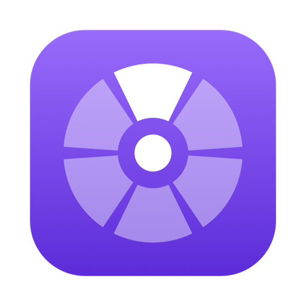
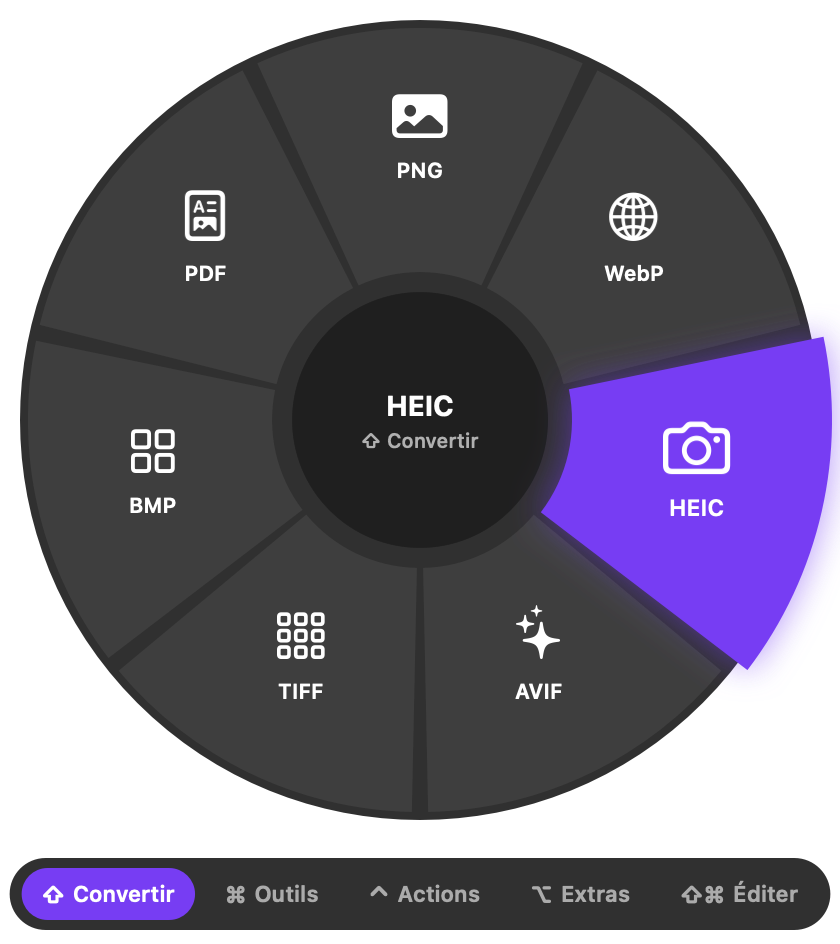

<p align="center"></p>

<h1 align="center">Zeste</h1>

<p align="center">
  Convertis, retouche et partage tes fichiers d'un simple glisser.<br>
  Gratuit, open source, 100 % hors ligne, pour Mac.
</p>

<p align="center">
  <a href="https://github.com/ArthurCissac/zeste/releases/latest/download/Zeste.dmg"><b>Télécharger Zeste.dmg</b></a> ·
  <a href="https://arthurcissac.github.io/zeste/">Page de présentation</a>
</p>

<p align="center"></p>

## Comment ça marche

Glisse un ou plusieurs fichiers et, sans lâcher, appuie sur une touche. Une roue apparaît sous
le curseur : dépose le fichier sur la part voulue. Le résultat arrive à côté de l'original,
qui n'est jamais modifié. Au centre de la roue, on annule.

| Touche | Roue | Exemples |
|---|---|---|
| ⇧ | Convertir | JPG, PNG, WebP, HEIC, AVIF, MP4, WebM, GIF, MP3, PDF, Word, EPUB… |
| ⌘ | Outils | compresser, redimensionner, recadrer, découper, fusionner, favicon… |
| ⌃ | Actions | AirDrop, fenêtre flottante, copier, déplacer, copier le chemin, Terminal |
| ⌥ | Extras | formats réseaux sociaux, sous-titres automatiques, lire texte et QR codes, poids cible |
| ⇧⌘ | Éditer | retoucher une photo ou une vidéo, retirer le fond, couper sur la forme d'onde |

Sans souris : sélectionne un fichier dans le Finder et fais ⌃⌥Espace, puis flèches, Tab et Entrée.

## Installer

1. Télécharge [Zeste.dmg](https://github.com/ArthurCissac/zeste/releases/latest/download/Zeste.dmg).
2. Ouvre-le et glisse Zeste dans Applications.
3. Ouvre Zeste : son icône apparaît dans la barre des menus.

Il faut un Mac avec puce Apple et macOS 14 ou plus récent. L'app est signée (Developer ID) et
notarisée par Apple.

## Confidentialité

Tout est calculé sur le Mac : conversions, transcription, détourage, lecture de texte. Aucun
fichier n'est envoyé en ligne, et l'app ne contient ni suivi ni publicité.

## Construire depuis les sources

```bash
./scripts/build-ffmpeg.sh   # une fois : ffmpeg autonome, LGPL, macOS 14+
./scripts/build-app.sh      # compile, signe et installe ~/Applications/Zeste.app
./scripts/release.sh        # Zeste.dmg notarisé (certificat Developer ID requis)
```

Prérequis : Xcode, Homebrew (pour les sources des bibliothèques audio et vidéo).

### Moteurs

- Images : ImageIO ; WebP par libwebp.
- Vidéo, audio : FFmpeg embarqué (H.264 par VideoToolbox d'Apple).
- PDF et textes : PDFKit et AppKit ; Word, Pages, Keynote et Numbers via les apps d'Apple.
- Sous-titres, texte, QR codes, détourage : Speech et Vision, sur l'appareil.
- Archives : `ditto`, `zip`, `tar`.

### Tester sans interface

```bash
.build/release/Zeste --run list fichier.png          # options proposées
.build/release/Zeste --run to-webp fichier.png       # une conversion
.build/release/Zeste --run snapshot 0 roue.png fichier.png
```

## Licence

Code sous licence [MIT](LICENSE). L'app distribuée embarque FFmpeg (LGPL 2.1) et d'autres
composants libres, détaillés dans [NOTICE.txt](NOTICE.txt).
